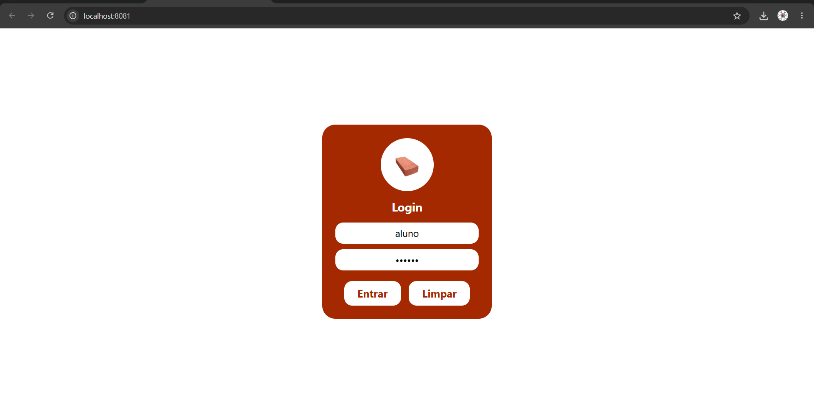
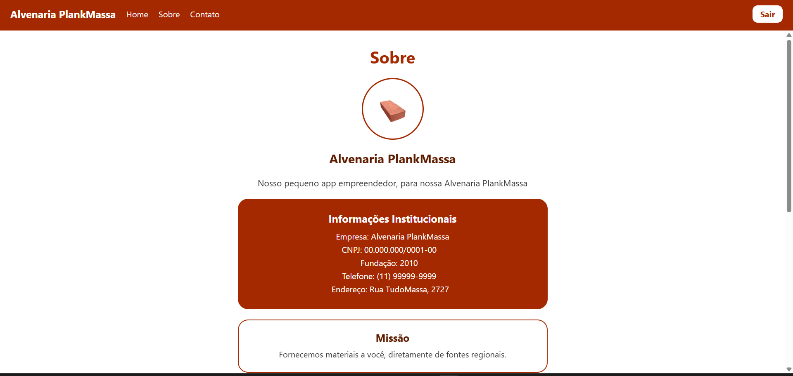
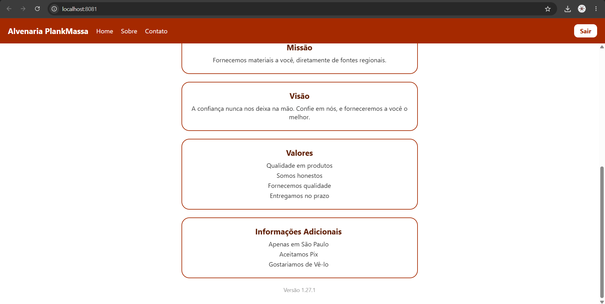
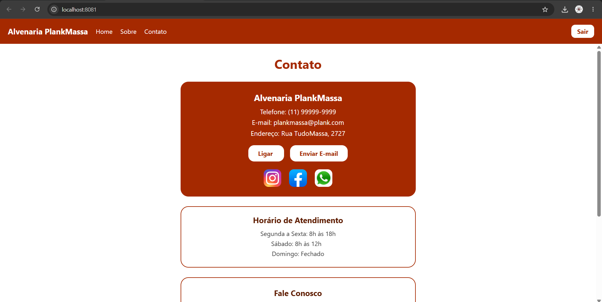
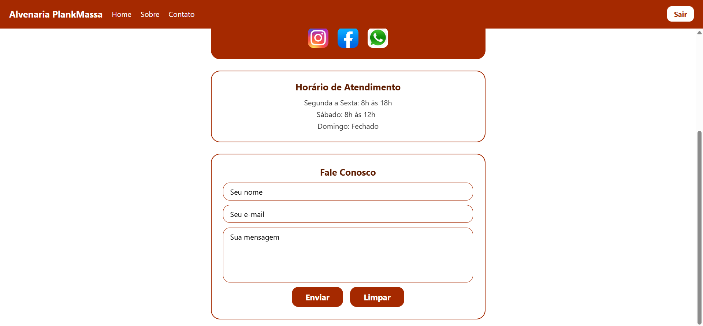
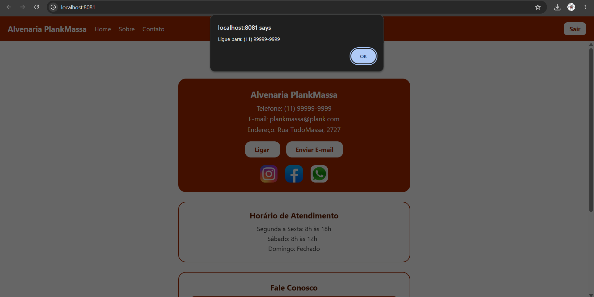
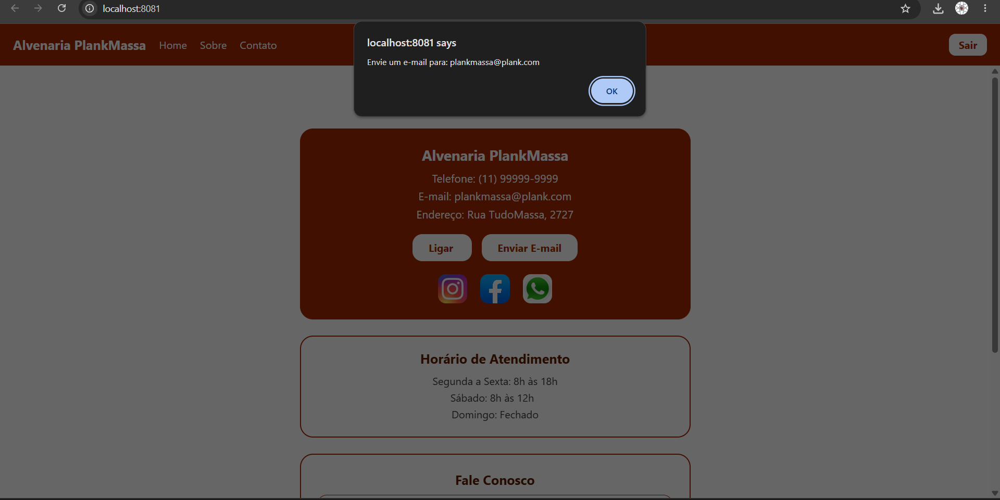
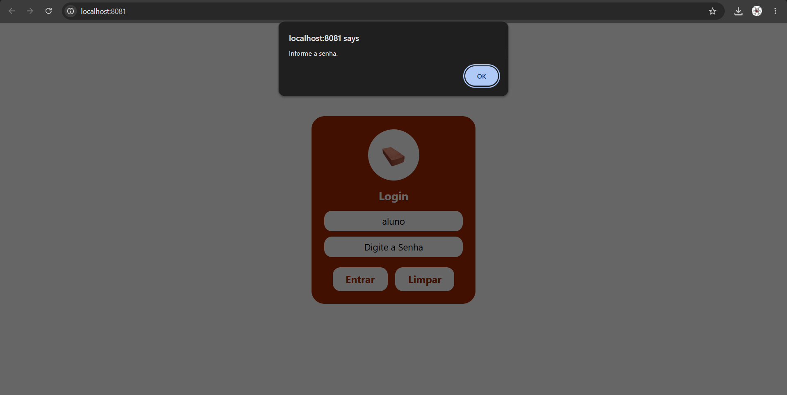
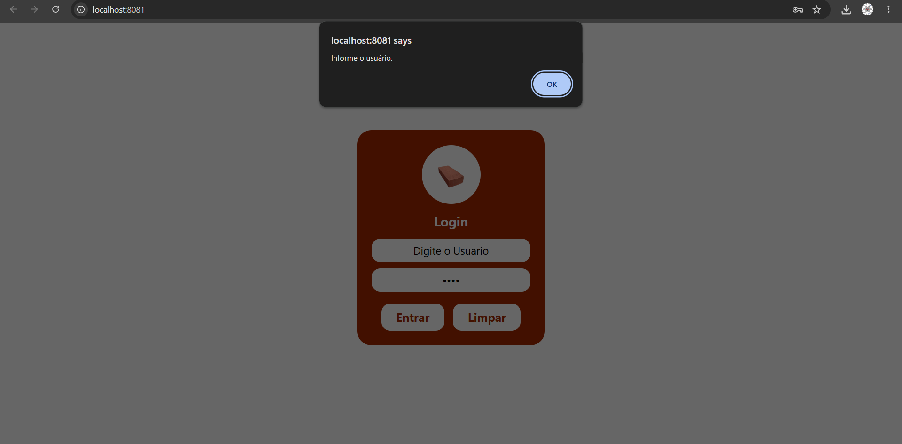
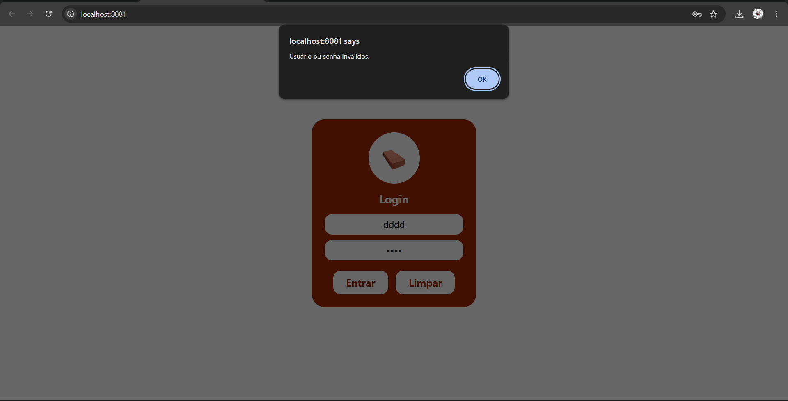

# AtividadeAplicacaoMobileComNavegacao
Construção de Aplicação Mobile com Login, Navegação e Toolbar

Lucas Lemos Veneziani

Aplicativo Alvenaria PlankMassa

É um aplicativo básico de alvenaria com tela de login e paginas home, sobre e contato, falando a respeito do que a empresa faz e onde contatar

Tecnologias: Vscode, React Native e Expo (Além de bibliotecas no react native e linguagem Javascript)

npm install para instalar todas as dependencias

npm run web para rodar na web

npm run dev para rodar aplicação na expo go

credenciais usadas:

usuario: aluno
senha: 123456

assets ficam as imagens

dentro de src\Pages ficam:

Contato
Home
Login
Menu
Sobre

Menu aparece em todas as telas menos Login

Cada uma delas tem um index.js e um style.js

Funcionalidades:

Temos um Formulario no Contato
Sistema de Login básico sem banco de dados e sem nada (apenas testa as credenciais acima e entra na home)

Toolbar funcional no Header que vai para paginas de home, contato e sobre,

botao de sair que volta para o login

Capturas de Tela

